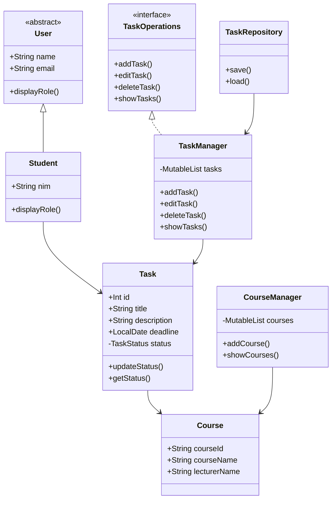
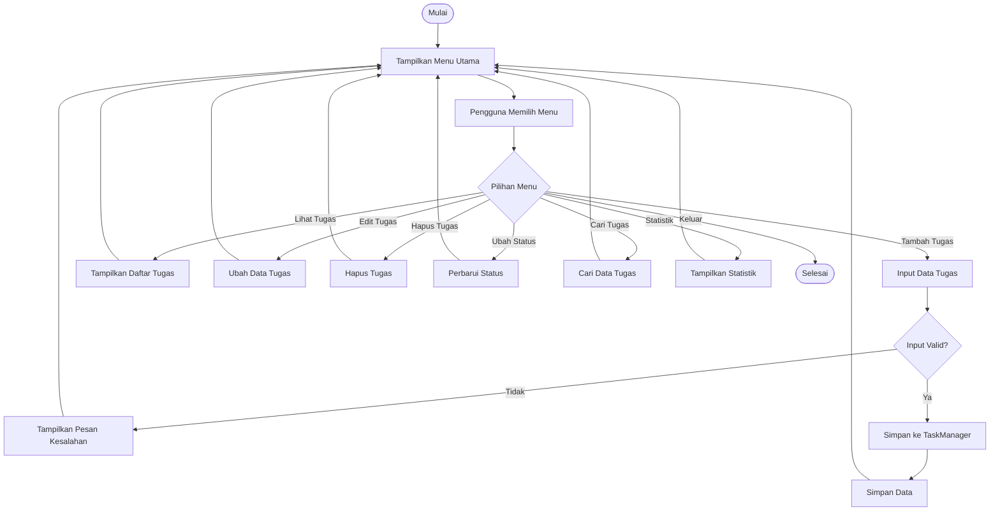
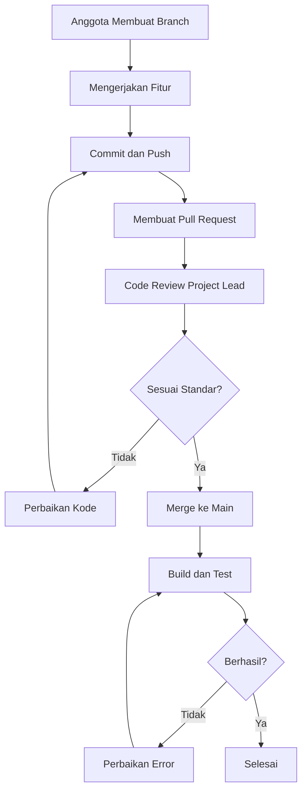

# Student Task Manager

**Aplikasi Manajemen Tugas Mahasiswa Berbasis Kotlin dengan Object-Oriented Programming (OOP)**


\


## 📌 Tentang Proyek

**Student Task Manager** merupakan aplikasi berbasis Kotlin yang dirancang untuk membantu mahasiswa mengelola tugas perkuliahan secara lebih terorganisasi.

Aplikasi ini berfokus pada pencatatan tugas, pengaturan deadline, penentuan prioritas, pengelolaan mata kuliah, serta pemantauan progres penyelesaian tugas.

Proyek ini dikembangkan menggunakan pendekatan **Object-Oriented Programming (OOP)** sebagai penerapan konsep pemrograman berorientasi objek, khususnya empat pilar OOP.

Pengembangan dilakukan secara kolaboratif menggunakan Git dan GitHub dengan pembagian tanggung jawab berdasarkan peran masing-masing anggota tim.

## 🎯 Tujuan Proyek

1. Membantu mahasiswa mencatat dan mengelola tugas perkuliahan.
2. Memudahkan mahasiswa mengatur deadline dan prioritas tugas.
3. Memantau status dan progres penyelesaian tugas.
4. Mengelola daftar mata kuliah.
5. Menerapkan empat pilar Object-Oriented Programming.
6. Menerapkan relasi antarobjek dalam pemrograman Kotlin.
7. Menerapkan penyimpanan data secara permanen.
8. Melatih kolaborasi pengembangan perangkat lunak menggunakan Git dan GitHub.

## ✨ Fitur Aplikasi

Berikut fitur yang direncanakan untuk dikembangkan:

| No. | Fitur              | Deskripsi                                    |
| --- | ------------------ | -------------------------------------------- |
| 1   | Tambah Tugas       | Menambahkan tugas baru                       |
| 2   | Lihat Tugas        | Menampilkan seluruh tugas                    |
| 3   | Edit Tugas         | Mengubah informasi tugas                     |
| 4   | Hapus Tugas        | Menghapus tugas                              |
| 5   | Ubah Status        | Memperbarui status pengerjaan                |
| 6   | Kelola Mata Kuliah | Menambah dan menampilkan mata kuliah         |
| 7   | Atur Prioritas     | Menentukan tingkat prioritas tugas           |
| 8   | Cari Tugas         | Mencari tugas berdasarkan informasi tertentu |
| 9   | Urutkan Deadline   | Mengurutkan tugas berdasarkan tenggat waktu  |
| 10  | Statistik Tugas    | Menampilkan informasi progres pengerjaan     |
| 11  | Penyimpanan Data   | Menyimpan dan membaca data kembali           |

### Rancangan Menu Utama

```text
====================================
       STUDENT TASK MANAGER
====================================

1. Tambah Mata Kuliah
2. Lihat Mata Kuliah
3. Tambah Tugas
4. Lihat Semua Tugas
5. Edit Tugas
6. Hapus Tugas
7. Ubah Status Tugas
8. Cari Tugas
9. Urutkan Deadline
10. Statistik Tugas
11. Simpan Data
0. Keluar

====================================
Pilih menu: _
```

## 🛠️ Teknologi yang Digunakan

| Teknologi                   | Kegunaan                              |
| --------------------------- | ------------------------------------- |
| Kotlin                      | Bahasa pemrograman utama              |
| IntelliJ IDEA               | IDE pengembangan                      |
| Gradle                      | Build system                          |
| Git                         | Version control                       |
| GitHub                      | Kolaborasi dan pengelolaan repository |
| Kotlin Serialization / JSON | Rancangan penyimpanan data            |
| GitHub Actions              | Continuous Integration                |

**Platform:** CLI / Terminal
**Target runtime:** JVM
**JDK:** Versi LTS yang disepakati oleh tim.

## 🧩 Penerapan Object-Oriented Programming

Proyek ini dirancang untuk menerapkan empat pilar utama OOP.

### 1. Encapsulation

Encapsulation digunakan untuk melindungi data agar tidak dapat diubah secara sembarangan.

Contoh penerapan:

- Status tugas menggunakan atribut `private`.
- Perubahan status dilakukan melalui method khusus.
- Akses terhadap data diatur menggunakan access modifier.

### 2. Inheritance

Inheritance digunakan untuk membentuk hubungan pewarisan antarclass.

Contoh:

- `User` menjadi abstract class.
- `Student` mewarisi class `User`.

### 3. Polymorphism

Polymorphism diterapkan melalui method overriding.

Contoh:

- `Student` melakukan override terhadap method `displayRole()` milik `User`.

### 4. Abstraction

Abstraction digunakan untuk menyederhanakan struktur dan menentukan kontrak operasi.

Contoh:

- Abstract class `User`.
- Interface `TaskOperations` sebagai kontrak operasi pengelolaan tugas.

> Penerapan setiap konsep OOP harus memiliki tujuan desain yang jelas, bukan sekadar memenuhi jumlah konsep.

## 🏗️ Rancangan Arsitektur Sistem

### Class yang Direncanakan

| Class / Interface | Fungsi                          |
| ----------------- | ------------------------------- |
| `User`            | Abstract class pengguna         |
| `Student`         | Identitas mahasiswa             |
| `Lecturer`        | Informasi dosen jika diperlukan |
| `Task`            | Objek tugas                     |
| `Course`          | Objek mata kuliah               |
| `TaskManager`     | Pengelola operasi tugas         |
| `CourseManager`   | Pengelola operasi mata kuliah   |
| `TaskRepository`  | Pengelola penyimpanan data      |
| `TaskOperations`  | Kontrak operasi tugas           |
| `TaskStatus`      | Enum status tugas               |
| `Priority`        | Enum prioritas tugas            |

`Lecturer` dapat ditambahkan sesuai kebutuhan. Jika dosen hanya menjadi informasi mata kuliah, atribut `lecturerName` pada `Course` dapat digunakan tanpa harus menjadikan dosen sebagai pengguna aplikasi.

### Rancangan Class Diagram



## 📁 Struktur Folder Proyek

Berikut struktur folder yang direncanakan untuk menjaga kode tetap terorganisasi.

```text
StudentTaskManager/
│
├── .github/
│   └── workflows/
│       └── kotlin-ci.yml
│
├── docs/
│   ├── PROJECT_CHARTER.md
│   ├── REQUIREMENTS.md
│   ├── USE_CASE.md
│   ├── CLASS_DIAGRAM.md
│   ├── FLOWCHART.md
│   ├── ARCHITECTURE.md
│   ├── TESTING_REPORT.md
│   └── TEAM_ROLES.md
│
├── src/
│   ├── main/
│   │   └── kotlin/
│   │       ├── model/
│   │       │   ├── User.kt
│   │       │   ├── Student.kt
│   │       │   ├── Lecturer.kt
│   │       │   ├── Task.kt
│   │       │   ├── Course.kt
│   │       │   ├── TaskStatus.kt
│   │       │   └── Priority.kt
│   │       │
│   │       ├── contracts/
│   │       │   └── TaskOperations.kt
│   │       │
│   │       ├── service/
│   │       │   ├── TaskManager.kt
│   │       │   └── CourseManager.kt
│   │       │
│   │       ├── exception/
│   │       │   ├── TaskNotFoundException.kt
│   │       │   └── InvalidTaskException.kt
│   │       │
│   │       ├── repository/
│   │       │   └── TaskRepository.kt
│   │       │
│   │       ├── ui/
│   │       │   └── Menu.kt
│   │       │
│   │       └── Main.kt
│   │
│   └── test/
│       └── kotlin/
│           ├── TaskTest.kt
│           ├── TaskManagerTest.kt
│           └── CourseManagerTest.kt
│
├── data/
├── README.md
├── Dockerfile
├── build.gradle.kts
└── settings.gradle.kts
```

**Keterangan:**

- `model/` berisi class dan objek utama aplikasi.
- `contracts/` berisi interface atau kontrak operasi.
- `service/` berisi business logic.
- `exception/` berisi penanganan kesalahan khusus.
- `repository/` berisi mekanisme penyimpanan dan pembacaan data.
- `ui/` berisi tampilan menu CLI.
- `data/` digunakan untuk menyimpan data runtime.
- `docs/` berisi dokumentasi perancangan dan pengujian.
- `src/test/` berisi unit testing.

## 📋 Kebutuhan Sistem

### Functional Requirements

| Kode  | Kebutuhan                               |
| ----- | --------------------------------------- |
| FR-01 | Sistem dapat menambahkan tugas          |
| FR-02 | Sistem dapat menampilkan tugas          |
| FR-03 | Sistem dapat mengedit tugas             |
| FR-04 | Sistem dapat menghapus tugas            |
| FR-05 | Sistem dapat mengubah status tugas      |
| FR-06 | Sistem dapat mengelola mata kuliah      |
| FR-07 | Sistem dapat mengatur prioritas         |
| FR-08 | Sistem dapat mencari tugas              |
| FR-09 | Sistem dapat mengurutkan deadline       |
| FR-10 | Sistem dapat menampilkan statistik      |
| FR-11 | Sistem dapat menyimpan dan membaca data |

### Non-Functional Requirements

1. Menggunakan bahasa pemrograman Kotlin.
2. Menerapkan konsep Object-Oriented Programming.
3. Memiliki struktur folder yang terorganisasi.
4. Memiliki kode yang mudah dipahami dan dikembangkan.
5. Melakukan validasi input pengguna.
6. Menangani kesalahan program dengan baik.
7. Menyimpan data secara permanen.
8. Dapat dijalankan pada komputer seluruh anggota tim.

## 🔄 Alur Kerja Aplikasi

Berikut gambaran umum alur pengelolaan tugas:



## 🔗 Kontrak Kode Antarclass

Sebelum proses coding dimulai, seluruh anggota harus menyepakati nama class, atribut, parameter, dan method agar setiap modul dapat diintegrasikan.

### Ketentuan Class Task

```kotlin
class Task(
    val id: Int,
    var title: String,
    var description: String,
    var deadline: LocalDate,
    var course: Course,
    var priority: Priority
) {
    private var status: TaskStatus =
        TaskStatus.NOT_STARTED

    fun updateStatus(newStatus: TaskStatus)

    fun getStatus(): TaskStatus
}
```

### Interface TaskOperations

```kotlin
interface TaskOperations {
    fun addTask(task: Task)
    fun showTasks()
    fun editTask(id: Int)
    fun deleteTask(id: Int)
    fun updateTaskStatus(id: Int)
}
```

### Class TaskManager

```kotlin
class TaskManager : TaskOperations {
    // Implementasi operasi pengelolaan tugas
}
```

### Aturan Data

| Komponen        | Ketentuan                                        |
| --------------- | ------------------------------------------------ |
| Format tanggal  | `YYYY-MM-DD`                                     |
| Status awal     | `NOT_STARTED`                                    |
| Status berjalan | `IN_PROGRESS`                                    |
| Status selesai  | `COMPLETED`                                      |
| Prioritas       | `LOW`, `MEDIUM`, `HIGH`                          |
| ID tugas        | Harus unik                                       |
| ID mata kuliah  | Harus unik                                       |
| Judul tugas     | Tidak boleh kosong                               |
| Deadline        | Harus valid                                      |
| Relasi tugas    | Harus terhubung dengan mata kuliah yang tersedia |

Kontrak ini menjadi pedoman bersama dan dapat diperbarui melalui kesepakatan tim sebelum implementasi.

## 👥 Pembagian Tugas Tim

Pembagian tanggung jawab berdasarkan rancangan proyek:

| Anggota | Peran                    | Tanggung Jawab                                      |
| ------- | ------------------------ | --------------------------------------------------- |
| Kamu    | Project Lead / Arsitek   | Perencanaan, UML, koordinasi, arsitektur, integrasi |
| Teman 1 | Domain Developer         | Model, relasi class, dan konsep OOP                 |
| Teman 2 | Business Logic Developer | Service, CRUD, validasi, dan exception              |
| Teman 3 | UI / CLI Developer       | Menu dan interaksi pengguna                         |
| Teman 4 | QA + Data & Persistence  | Testing dan penyimpanan data                        |
| Teman 5 | DevOps                   | GitHub, CI, dan konfigurasi proyek                  |

*Catatan: jumlah peran dapat disesuaikan dengan jumlah anggota kelompok. Jika anggota hanya lima orang termasuk Project Lead, tugas DevOps dapat digabung dengan QA atau dikerjakan bersama.*

### Tanggung Jawab Project Lead

- Menentukan tujuan dan ruang lingkup proyek.
- Menyusun Project Charter.
- Memimpin analisis kebutuhan.
- Membuat Use Case Diagram dan Class Diagram.
- Menentukan struktur folder.
- Menyepakati kontrak kode antarclass.
- Mengelola repository GitHub.
- Membuat dan mengatur Issues serta Project Board.
- Melakukan code review terhadap Pull Request.
- Memimpin proses integrasi.
- Memastikan seluruh modul berjalan.
- Mengarahkan finalisasi dokumentasi dan presentasi.

## 🌿 GitHub Collaboration

Proyek menggunakan GitHub sebagai tempat kolaborasi seluruh anggota.

### Branch Structure

```text
main
│
├── feature/domain-model
├── feature/business-logic
├── feature/ui-cli
├── feature/persistence
├── feature/testing
└── feature/devops
```

### Aturan Kolaborasi

1. Setiap anggota bekerja pada branch masing-masing.
2. Branch `main` tidak boleh diubah secara langsung.
3. Setiap perubahan harus dikirim melalui Pull Request.
4. Pull Request harus diperiksa sebelum digabungkan.
5. Penamaan class dan method harus mengikuti kontrak kode.
6. Setiap anggota wajib melakukan pengujian sebelum mengirim Pull Request.
7. Perubahan struktur kode harus dikomunikasikan kepada tim.

### Alur Pull Request



### GitHub Project Board

Gunakan empat kolom untuk memantau pekerjaan:

| Kolom       | Keterangan                        |
| ----------- | --------------------------------- |
| To Do       | Pekerjaan belum dimulai           |
| In Progress | Pekerjaan sedang dilakukan        |
| Review      | Menunggu pemeriksaan Pull Request |
| Done        | Pekerjaan selesai                 |

## 💾 Penyimpanan Data

Aplikasi direncanakan memiliki mekanisme penyimpanan data agar tugas dan mata kuliah tetap tersedia ketika aplikasi dijalankan kembali.

Alternatif penyimpanan:

| Metode | Kelebihan                       | Kekurangan                                |
| ------ | ------------------------------- | ----------------------------------------- |
| JSON   | Mudah dibaca dan dipahami       | Memerlukan pengelolaan format dan parsing |
| SQLite | Terstruktur dan mendukung query | Memerlukan konfigurasi database           |

Untuk versi CLI pertama, JSON direkomendasikan menggunakan Kotlin Serialization. SQLite dapat digunakan jika kebutuhan proyek mengharuskannya.

## 🧪 Testing dan Quality Assurance

Pengujian dilakukan untuk memastikan seluruh fitur berjalan sesuai kebutuhan.

### Test Case

| No. | Skenario Pengujian        | Hasil yang Diharapkan       |
| --- | ------------------------- | --------------------------- |
| 1   | Menambahkan tugas valid   | Tugas berhasil disimpan     |
| 2   | Menambahkan ID duplikat   | Sistem menolak data         |
| 3   | Menambahkan judul kosong  | Sistem menolak data         |
| 4   | Menampilkan tugas         | Data tampil                 |
| 5   | Mengedit tugas            | Data berhasil berubah       |
| 6   | Menghapus tugas           | Data berhasil dihapus       |
| 7   | Mengubah status           | Status berhasil berubah     |
| 8   | Mencari ID tidak tersedia | Pesan tidak ditemukan       |
| 9   | Deadline tidak valid      | Pesan kesalahan ditampilkan |
| 10  | Mengurutkan deadline      | Data terurut                |
| 11  | Menyimpan data            | File berhasil dibuat        |
| 12  | Membuka ulang aplikasi    | Data sebelumnya terbaca     |
| 13  | Menghitung statistik      | Perhitungan benar           |

### Pengujian Empat Pilar OOP

| Konsep        | Hal yang Diperiksa                                      |
| ------------- | ------------------------------------------------------- |
| Encapsulation | Data private tidak diubah sembarangan                   |
| Inheritance   | Class turunan mewarisi class induk                      |
| Polymorphism  | Method override memberikan perilaku berbeda             |
| Abstraction   | Interface dan abstract class memiliki fungsi yang jelas |

### Integration Testing

Pastikan seluruh modul dapat berkomunikasi:

- UI dapat memanggil `TaskManager`.
- `TaskManager` dapat mengelola objek `Task`.
- `Task` dapat terhubung dengan `Course`.
- `TaskRepository` dapat menyimpan data.
- Data dapat dimuat kembali ketika aplikasi dijalankan.

Hasil pengujian akan didokumentasikan dalam `TESTING_REPORT.md`.

## 🚀 Cara Menjalankan Proyek

### Persyaratan

Pastikan perangkat sudah memiliki:

- JDK versi LTS yang disepakati tim.
- IntelliJ IDEA.
- Kotlin.
- Gradle.
- Git.

### Clone Repository

Ganti alamat berikut dengan URL repository proyek yang digunakan oleh kelompok.

```bash
git clone <URL_REPOSITORY>
```

Masuk ke direktori proyek:

```bash
cd StudentTaskManager
```

### Membuka Proyek

1. Buka IntelliJ IDEA.
2. Pilih Open Project.
3. Pilih folder `StudentTaskManager`.
4. Tunggu Gradle melakukan sinkronisasi.
5. Pastikan konfigurasi proyek berhasil.
6. Buka file `Main.kt`.
7. Jalankan program.

Jika Gradle Wrapper dan konfigurasi application plugin sudah tersedia, proyek juga dapat dijalankan melalui terminal:

```bash
./gradlew run
```

Untuk Windows:

```bash
gradlew.bat run
```

Menjalankan pengujian:

```bash
./gradlew test
```

Membangun proyek:

```bash
./gradlew build
```

## 📅 Timeline Pengerjaan

Contoh timeline pengerjaan selama 21 hari:

| Hari  | Kegiatan                          | Penanggung Jawab        |
| ----- | --------------------------------- | ----------------------- |
| 1     | Persiapan dan Project Charter     | Project Lead            |
| 2     | Rapat pertama dan pembagian peran | Semua                   |
| 3     | Analisis kebutuhan                | Project Lead + Tim      |
| 4     | Use Case dan Flowchart            | Project Lead            |
| 5     | Class Diagram dan arsitektur      | Project Lead            |
| 6     | Setup GitHub dan Kotlin           | Project Lead + DevOps   |
| 7     | Kesepakatan kontrak kode          | Semua                   |
| 8–10  | Pembuatan model dan service       | Domain + Business Logic |
| 8–11  | Repository dan testing awal       | QA + Persistence        |
| 9–12  | Pembuatan UI / CLI                | UI Developer            |
| 11–13 | CI dan konfigurasi proyek         | DevOps                  |
| 14–15 | Integrasi seluruh modul           | Semua                   |
| 16–17 | Testing dan perbaikan bug         | QA + Semua              |
| 18    | Finalisasi fitur                  | Semua                   |
| 19    | Dokumentasi                       | Semua                   |
| 20    | Persiapan presentasi              | Semua                   |
| 21    | Evaluasi dan finalisasi           | Project Lead + Semua    |

Timeline dapat disesuaikan dengan deadline yang diberikan dosen.

## 📚 Dokumentasi Proyek

Dokumentasi tambahan direncanakan berada di folder `docs/`:

| File                 | Isi                                         |
| -------------------- | ------------------------------------------- |
| `PROJECT_CHARTER.md` | Identitas, tujuan, dan ruang lingkup proyek |
| `REQUIREMENTS.md`    | Kebutuhan fungsional dan nonfungsional      |
| `USE_CASE.md`        | Use Case Diagram dan penjelasan aktor       |
| `CLASS_DIAGRAM.md`   | Struktur class dan relasi                   |
| `FLOWCHART.md`       | Alur proses aplikasi                        |
| `ARCHITECTURE.md`    | Arsitektur sistem dan penerapan OOP         |
| `TESTING_REPORT.md`  | Hasil pengujian aplikasi                    |
| `TEAM_ROLES.md`      | Pembagian peran dan tanggung jawab          |

## 🎤 Rencana Demonstrasi

Pada saat presentasi, tim dapat menunjukkan alur penggunaan aplikasi berikut:

1. Menjalankan aplikasi melalui IntelliJ IDEA.
2. Menambahkan mata kuliah.
3. Menambahkan tugas baru.
4. Menampilkan seluruh tugas.
5. Mengubah status tugas menjadi `IN_PROGRESS`.
6. Mengedit informasi tugas.
7. Menghapus salah satu tugas.
8. Melihat statistik penyelesaian.
9. Menutup aplikasi dan menjalankannya kembali untuk membuktikan data tersimpan.

Setiap anggota juga perlu memahami kontribusi masing-masing agar dapat menjelaskan bagian yang dikerjakan dan menjawab pertanyaan saat presentasi.

## ✅ Final Project Checklist

### Persiapan

- [ ] Project Charter selesai.
- [ ] Tujuan dan ruang lingkup disepakati.
- [ ] Pembagian anggota selesai.
- [ ] Timeline dibuat.

### Analisis dan Desain

- [ ] Requirements selesai.
- [ ] Use Case Diagram selesai.
- [ ] Class Diagram selesai.
- [ ] Flowchart selesai.
- [ ] Struktur folder disepakati.

### Pengembangan

- [ ] Semua model class selesai.
- [ ] Business Logic selesai.
- [ ] UI / CLI selesai.
- [ ] Persistence selesai.
- [ ] Exception handling selesai.

### Kolaborasi

- [ ] Repository GitHub tersedia.
- [ ] Semua anggota menggunakan branch masing-masing.
- [ ] Pull Request sudah direview.
- [ ] Semua modul sudah digabungkan.

### Pengujian dan Finalisasi

- [ ] Unit testing selesai.
- [ ] Integration testing selesai.
- [ ] Build berhasil.
- [ ] Data berhasil disimpan dan dibaca.
- [ ] README selesai.
- [ ] Dokumentasi selesai.
- [ ] Presentasi siap.

## 👨‍💻 Tim Pengembang

Isi bagian berikut dengan identitas anggota kelompok:

| No. | Nama Anggota             | Peran                    |
| --- | ------------------------ | ------------------------ |
| 1   | Rizky Satria Pratama     | Project Lead / Arsitek   |
| 2   | Adema Medsuzabe Areta    | Domain Developer         |
| 3   | Muhammad Zaky Rahman     | Business Logic Developer |
| 4   | Hafzi Hammadi Rafsanjani | UI / CLI Developer       |
| 5   | Muhammad Khotami Putra   | QA + Data & Persistence  |
| 6   | Faiz Nafil               | DevOps                   |

*Sesuaikan tabel dengan jumlah anggota kelompok yang sebenarnya.*

## 📌 Catatan Pengembangan

Proyek ini mengikuti urutan pengembangan:

**Tentukan apa yang akan dibuat → Rancang bagaimana sistem bekerja → Sepakati bagaimana kode saling terhubung → Mulai coding → Integrasikan → Uji → Dokumentasikan → Presentasikan.**

Urutan tersebut digunakan untuk mengurangi konflik kode, pekerjaan yang tumpang tindih, dan kesulitan ketika menggabungkan modul.

---

**Student Task Manager — Kotlin OOP Project**

Dikembangkan sebagai proyek pembelajaran Object-Oriented Programming dan kolaborasi pengembangan perangkat lunak menggunakan GitHub.
